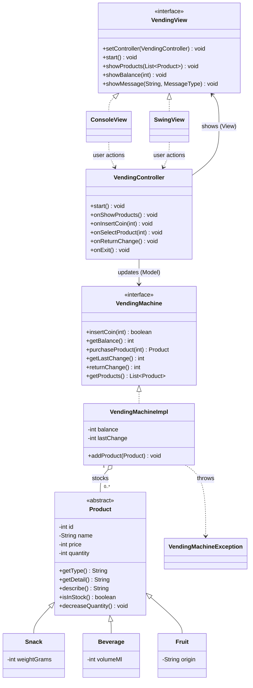

# Workshop — OOP (Vending Machine)

---

## The Scenario

A new vending machine is being installed in the Lexicon break room and it needs software to run.

The machine stocks three categories of products: **snacks**, **beverages**, and **fruits**. Every product has a name, a price, and a stock quantity. But each category also carries its own detail — a snack has a weight in grams, a beverage has a volume in ml, and a fruit has a country of origin. When a product is displayed, it should describe itself including that specific detail.

The machine runs on coins. It accepts only the standard Swedish coin values: **1, 2, 5, 10, 20, and 50 kr**. Any other value is rejected immediately and the balance does not change.

Here is what a typical session looks like:

```
Welcome to Lexicon Vending Machine
------------------------------------
[1] Chips        - 15 kr  (Snack, 130g)     Stock: 5
[2] Cola         - 20 kr  (Beverage, 330ml)  Stock: 3
[3] Apple        - 10 kr  (Fruit, Sweden)    Stock: 8
------------------------------------
Balance: 0 kr

> Insert coin: 10
Balance: 10 kr

> Insert coin: 7
Invalid coin. Only 1, 2, 5, 10, 20, 50 kr accepted.
Balance: 10 kr

> Insert coin: 10
Balance: 20 kr

> Select product: 2
Dispensing: Cola (Beverage, 330ml)
Balance: 0 kr

> Select product: 1
Insufficient balance. Chips costs 15 kr.

> Insert coin: 20
Balance: 20 kr

> Select product: 1
Dispensing: Chips (Snack, 130g)
Change returned: 5 kr
Balance: 0 kr

> Return change
No balance to return.
```

The machine must also handle edge cases cleanly: if a product is out of stock, the user gets a clear message. If the user asks for change when the balance is already 0, the machine says so.

---

## Required Functionalities

### Products
- The machine stocks three product types: **Snack**, **Beverage**, and **Fruit**
- All products share: `id`, `name`, `price (int, in kr)`, `quantity`
- Each type adds its own specific field:
  - `Snack` → `weightGrams: int`
  - `Beverage` → `volumeMl: int`
  - `Fruit` → `origin: String`
- Every product must be able to describe itself — output format: `[name] ([type], [specific detail])`
- A product that cannot describe itself (plain product) should not be possible to create

### Payment
- Accepted coin values: `1, 2, 5, 10, 20, 50`
- Any other value is rejected — balance does not change, print a rejection message
- Each inserted valid coin adds to the current balance
- The user can request their remaining balance back at any time — balance resets to 0

### Purchase
- The user selects a product by its `id`
- If the product does not exist: print a clear message
- If the balance is less than the price: print how much is missing, do not deduct balance
- If the product is out of stock: print a clear message
- If the purchase succeeds: deduct the price from the balance, reduce stock by 1, print a confirmation
- If the balance exceeds the price after purchase: return the difference automatically

### Console UI
- On startup: display all products with their id, name, price, type detail, and stock
- Show the current balance after every action
- Accept user input in a loop until the user chooses to exit
- Keep the UI logic separate from the machine logic

---

## Your Task

### Step 1 — Model the System

Before writing any code, draw a class diagram.

Think about:
- What is shared across all product types? Where does that live?
- Can you ever create a plain `Product` with no type? What does that tell you?
- What does the vending machine need to do? Should that be a class or an interface — and why?
- Which classes know about which? Draw the relationships with the correct arrows and multiplicity.

Draw your diagram with all classes, fields, key methods, relationship arrows, and multiplicity.

### Step 2 — Implement the System

Build the application based on your model. Your implementation must:

- Use **inheritance** for the product hierarchy
- Use **polymorphism** when displaying or processing products — no `instanceof` checks
- Apply **encapsulation** — private fields, validated constructors
- Keep **console UI logic separate** from machine logic
- **Build a runnable JAR** that can be launched from the command line

---

## JUnit Tests

Write JUnit tests for the vending machine logic. Test the business rules — not the console output.

> Test `VendingMachineImpl` directly. Do not test the console view.

### Test Case 1 — Insert Valid Coin
**Given:** balance = 0
**When:** `insertCoin(10)`
**Then:** balance = 10

---

### Test Case 2 — Reject Invalid Coin
**Given:** balance = 0
**When:** `insertCoin(7)`
**Then:** balance stays 0

---

### Test Case 3 — Purchase Succeeds
**Given:** product price = 20, quantity = 3, balance = 0
**When:** `insertCoin(20)`, `purchaseProduct(id)`
**Then:** purchase returns the product, balance = 0, quantity = 2

---

### Test Case 4 — Purchase Fails — Insufficient Balance
**Given:** product price = 20, balance = 10
**When:** `purchaseProduct(id)`
**Then:** purchase fails, balance stays 10, quantity unchanged

---

### Test Case 5 — Purchase Fails — Out of Stock
**Given:** quantity = 0, balance >= price
**When:** `purchaseProduct(id)`
**Then:** purchase fails, balance unchanged, quantity stays 0

---

### Test Case 6 — Return Change
**Given:** balance = 50
**When:** `returnChange()`
**Then:** returns 50, balance = 0

---

### Test Case 7 — Product List
**Given:** machine has 3 products added
**When:** `getProducts()`
**Then:** list size = 3

---

## Class Diagram (MVC)

The application follows **Model – View – Controller**:

| Part | Package | Responsibility |
|------|---------|----------------|
| **Model** | `se.lexicon.model` | Products, balance, stock and all business rules (`VendingMachine`, `VendingMachineImpl`, `Product`, ...) |
| **View** | `se.lexicon.view` | Shows data and forwards user actions (`ConsoleView`, `SwingView`). No business rules |
| **Controller** | `se.lexicon.controller` | Receives actions from the view, calls the model, tells the view what to show (`VendingController`) |

`App` is the composition root: it creates the model and a view, then passes both to the controller.



`Product` is abstract because a plain product must not exist. `VendingMachine` and `VendingView` are interfaces, so the controller depends only on contracts: any model or view can be plugged in (and the controller is tested with a fake view).

---

## Screenshots (graphical UI)

The Swing view (`SwingView`) is a dark-themed window with product cards on the left and the payment panel on the right. Buy and Return-change buttons are only enabled when they can be used. The images below are in `docs/screenshots/`.

| | |
|---|---|
| **1. Start (balance 0 kr)**: every Buy button is disabled and says "Insert coin", Return change is disabled.  | **2. After inserting 10 + 5 kr**: the balance is 15 kr, Buy and Return change are enabled.  |
| **3. Buying Cola with too little money**: the machine's error message is shown and nothing changes.  | **4. After buying Chips with 35 kr**: the product is dispensed, 20 kr change is returned, stock drops from 5 to 4.  |

---

## Build and Run

Requires Java 25+ and Maven.

```bash
mvn clean package          # compiles, runs the JUnit tests, builds target/vending_machine-1.0-SNAPSHOT.jar
java -jar target/vending_machine-1.0-SNAPSHOT.jar             # graphical UI (default)
java -jar target/vending_machine-1.0-SNAPSHOT.jar --console   # console UI
```

Run only the tests with `mvn test`.

---

## Branches

The branches are stacked: each one adds a single commit on top of the previous one, so every step can be compared with a pull request or `git diff`.

You are viewing the README of the `feature/swing-graphical-ui` branch.

```
main  →  feature/mvc-architecture  →  feature/swing-graphical-ui
```

| Branch | What it contains | Based on |
|--------|------------------|----------|
| `main` | The required solution: product hierarchy (`Product`, `Snack`, `Beverage`, `Fruit`), the `VendingMachine` interface with `VendingMachineImpl`, a console UI (`ConsoleUI`) and the JUnit tests. Packages: `model`, `data`, `exception`, `ui`. No MVC and no graphical UI. | – |
| `feature/mvc-architecture` | Everything in `main`, restructured as **Model – View – Controller**: the machine logic moves into `model`, `ConsoleUI` becomes `ConsoleView` implementing the `VendingView` interface, and the new `VendingController` connects model and view. Console UI only. Adds controller tests that use a fake view. Packages: `model`, `view`, `controller`, `exception`. | `main` |
| `feature/swing-graphical-ui` | Everything in `feature/mvc-architecture` (MVC + console view), plus a modern dark-themed graphical view built with Swing (`SwingView`): product cards, coin buttons, live balance, and Buy / Return-change buttons that enable and disable with the balance. The graphical UI starts by default; `--console` starts the console view instead. | `feature/mvc-architecture` |

Switch between them with `git checkout <branch>`. The class diagram and package description in this README always match the code of the branch you are on; `feature/swing-graphical-ui` is the most complete version.

---

## Submission

When you are done:

1. Make sure your latest code is **committed and pushed to GitHub**
2. Include in the repository:
   - Your **class diagram** (image or Mermaid in the `README.md`)
   - The **source code** and **JUnit tests**
   - A short `README.md` describing how to build and run the JAR
3. **Share the GitHub repository link with your instructor**

